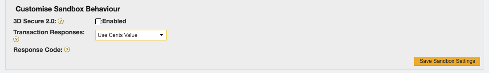

# Testing

## Running Tests

Tests use PHPUnit 9 with CiviCRM's headless test framework. Run the full suite from the extension root:

```bash
phpunit9
```

Or a single file:

```bash
phpunit9 tests/phpunit/CRM/eWAYRecurring/SettlementSyncTest.php
```

The bootstrap file (`tests/phpunit/bootstrap.php`) uses `cv php:boot` to initialise CiviCRM. Run tests from a directory where `cv` can locate your CiviCRM installation.

## Test Directory Structure

```
tests/phpunit/
  CRM/
    eWAYRecurring/
      SettlementSyncTest.php  ← headless (default run)
      E2ETest.php             ← @group e2e (excluded by default - see below)
```

## End-to-end tests

`E2ETest.php` drives real HTTP requests against a live, network-reachable
CiviCRM site and the actual eWAY sandbox gateway - it doesn't run under
`CIVICRM_UF=UnitTests` like the headless tests do, and needs a properly
configured site plus live eWAY sandbox credentials. `phpunit.xml.dist`
excludes `@group e2e` from the default `phpunit9` run; run it explicitly
in a suitable environment:

```bash
phpunit9 --group e2e
```

## Playwright tests

`tests/playwright/` holds the browser tests, with a fake eWAY so no test calls the real gateway. See its
[README](../tests/playwright/README.md) for how to run them. On GitHub they run through
`.github/workflows/frontend-tests.yml`.

## Setting up the eWAY sandbox

The real-sandbox Playwright cases (`PW-X-01` to `PW-X-05`, see the
[Playwright README](../tests/playwright/README.md)) and the end-to-end tests call eWAY's sandbox, so they need a sandbox
account. Its API key and password go in the environment variables `EWAY_SANDBOX_API_KEY` and
`EWAY_SANDBOX_API_PASSWORD` (never in a file in the repository). On GitHub they are organisation Actions secrets of the
same names, which `frontend-tests.yml` passes to the run on pushes and manual runs, not on pull requests.

The account must also be told how to answer test transactions. Out of the box it may approve every amount, which makes
the two decline cases skip because they would say nothing about the extension. Set it to decide by the cents value of
the amount:

1. Log in to your eWAY Sandbox account at <https://sandbox.myeway.com.au/BusinessCentre.aspx>.
2. Open the **Settings** tab and choose **Sandbox** from the dropdown menu.
3. Under **Transaction Responses**, select **Use Cents Value**.
4. Click **Save Sandbox Settings**.



The **Customise Sandbox Behaviour** section sets how the Business Centre responds to the dummy transactions you create.
The options for **Transaction Responses** are:

| Option | What it does |
| --- | --- |
| Always Approve | Transactions always approve. Invalid card numbers, expired cards and negative amounts still decline. |
| Always Decline | Transactions are always declined. You can optionally set a specific response code to be returned. |
| Use Cents Value | The cents value of the amount decides the result. For example $10.00 returns response code 00 (Transaction Approved). |

The tests need **Use Cents Value**: $10.00 is approved, $10.05 is declined (Do Not Honour) and $10.51 is declined
(Insufficient Funds). See eWAY's list of
[response codes](http://www.eway.com.au/Developer/payment-code/transaction-results-response-codes.aspx) for which
cents values pass or fail on the test gateway.

## Running the workflows on GitHub

The PHPUnit, upgrade and Playwright workflows run on pushes to `master`, on pull requests and on demand. To run one
on a branch without opening a pull request:

```bash
gh workflow run phpunit-tests.yml --ref release-3.0.0
gh workflow run upgrade-tests.yml --ref release-3.0.0
gh workflow run frontend-tests.yml --ref release-3.0.0
```

The run uses the workflow file as it is on that branch, so push the branch first if the file changed. A workflow
that GitHub has never seen run is only listed once its file is on the default branch, so a brand new workflow file
needs one run (a pull request, or a push while it still has a push trigger) before it can be started this way.

## Upgrade tests

`tests/upgrade/` checks that a site can upgrade from an older release without losing or changing data.
It is run on GitHub by `.github/workflows/upgrade-tests.yml`, which uses the shared workflow in
`agileware/ci-workflows`: it installs release 2.8.1 on a WordPress and CiviCRM site, seeds it
(`seed-v2.8.1.php`), replaces it with the commit under test, upgrades, and checks the result
(`verify-v3.php`). Every check is tagged with its ID from the UP suite in [TEST_PLAN.md](TEST_PLAN.md).

To rehearse it on a disposable local site that has `cv`, take a database snapshot first, because the
script seeds data and upgrades the site. Install the old release in the extension folder, copy the
version under test somewhere outside the site, and run the script from inside the extension folder:

```bash
EXTENSION_KEY=au.com.agileware.ewayrecurring \
EXTENSION_DIR=<the extension folder, holding release 2.8.1> \
NEW_VERSION_DIR=<a copy of the version under test> \
bash <NEW_VERSION_DIR>/tests/upgrade/ci-upgrade-test.sh
```

Restore the snapshot and the extension folder afterwards. When the seed data needs to change, edit
`seed-v2.8.1.php` and `verify-v3.php` together.

## Test plan and coverage status

[TEST_PLAN.md](TEST_PLAN.md) lists every planned test case with a stable ID and a status, and
records what is covered today. When you add or change a test, tag it with its plan ID (PHPUnit:
`@testPlan PU-F8` in the docblock; Playwright: start the test title with the ID), update the
status in the plan in the same pull request, and refresh its counts.

## Writing New Tests

New test classes should follow the pattern in `tests/phpunit/CRM/eWAYRecurring/SettlementSyncTest.php`:

- Place in `tests/phpunit/CRM/eWAYRecurring/` (match PSR-0 class path)
- Class name: `CRM_eWAYRecurring_YourClassTest`
- Extend `\PHPUnit\Framework\TestCase`
- Implement `HeadlessInterface, HookInterface, TransactionalInterface`
- Use `setUpHeadless()` to install the extension (not `setUpBeforeClass`)
- Use `Civi\Api4\*` for all database interactions
- `TransactionalInterface` handles rollback automatically, so no manual cleanup is needed
