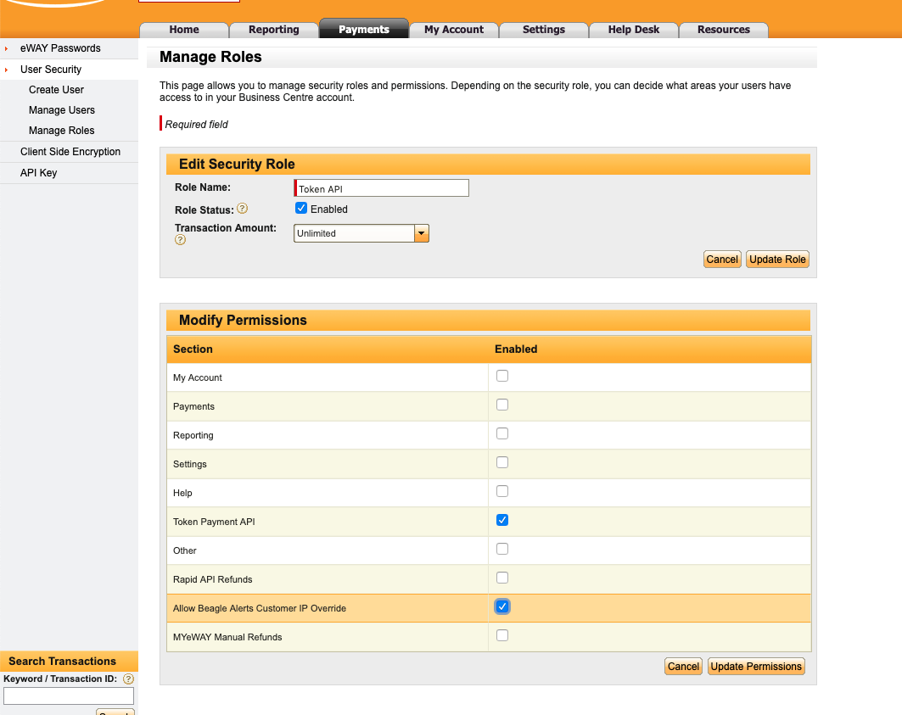
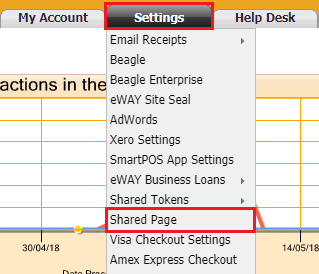
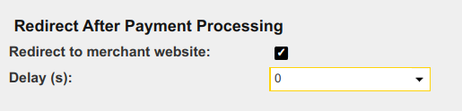

# eWay Recurring Payment Processor (au.com.agileware.ewayrecurring)

CiviCRM payment processor extension for [eWay](https://eway.com.au) which uses
the latest [eWay Rapid API](https://www.eway.com.au/features/api-rapid-api/) and
ensures [PCI DSS compliance](https://www.eway.com.au/about-eway/technology-security/pci-dss/).

Supports both once-off and recurring payments using eWay's secure token
payment method, so card details never touch your CiviCRM server. Recurring
billing is scheduled and processed by CiviCRM itself (not by a subscription
managed on eWay's side), which gives full control over retry behaviour for
failed payments. Provides:

* Once-off and recurring payments via eWay's Shared Page / Responsive Shared Page checkout
* Secure, tokenised "pay with saved card" for repeat/recurring contributions, without re-entering card details
* Configurable automatic retries for failed recurring payments, with a system status check for contributions that have exhausted their retries
* A Search Kit action to reactivate a failed Recurring Contribution
* Cancelling one contribution of a recurring contribution skips that installment and moves the next scheduled date on, so the recurring contribution is never left waiting
* A list of blocked recurring contributions, with Reactivate and Cancel buttons and a System Status warning, for records that a cancelled contribution stops being charged
* Background verification of pending/unconfirmed transactions, which keeps retrying a payment eWay approved but CiviCRM could not complete and leaves a note on the contribution saying what to do
* Automatic backfill of saved card metadata (expiry date, masked number) via the eWay Rapid API
* Automated reconciliation of a contribution's Fee Amount / Net Amount against eWay's Settlement Reports API (opt-in, disabled by default)

This extension is licensed under [GPL-3.0](https://github.com/agileware/au.com.agileware.ewayrecurring/blob/master/LICENSE.txt).

You will need an [eWay account](https://eway.com.au) with Rapid API access to
use this payment processor on your CiviCRM website.

## Usage

Once the extension is installed and a **eWay Recurring** payment processor
is configured (see [eWay API Key and Password](#eway-api-key-and-password)),
it can be selected as the payment processor on any Contribution Page, Event,
or Membership type like any other CiviCRM payment processor, for both
once-off and recurring payments.

### Scheduled Jobs

| Job | Frequency | Default | What it does |
| --- | --- | --- | --- |
| **eWay Recurring Payments** | Always | Enabled | Processes recurring contributions that are due, and retries failed ones on schedule (see [Failed eWay Transactions](#failed-eway-transactions)) |
| **eWay Transaction Verifications** | Always | Enabled | Verifies pending/unconfirmed transactions (see [eWay Transactions Verification](#eway-transactions-verification)) |
| **eWay Recurring: fill missing tokens metadata** | Hourly | Enabled | Backfills the expiry date / masked card number on stored Payment Tokens that are missing them, via the eWay Rapid API |
| **eWay Settlement Sync** | Daily | **Disabled** | Reconciles Fee Amount / Net Amount from eWay's Settlement Reports API (see [eWay Settlement Sync](#eway-settlement-sync)) |

All jobs are configurable at `civicrm/admin/job`.

### Permissions

* **CiviContribute: view payment tokens** and **CiviContribute: edit payment
  tokens** control who can view or manage a contact's stored eWay card
  tokens.
* **CiviContribute: edit contributions** controls who can open the
  **Failed Recurring Contributions** and **Blocked Recurring Contributions**
  lists (under **Contributions** in the menu) and use their Reactivate and
  Cancel buttons. These users do not need any access to payment processors.

### API

In addition to the standard `PaymentProcessor`/`Contribution`/`ContributionRecur`
APIs, this extension exposes:

* `EwayRecurring.fillTokensMeta` - manually trigger the saved-card metadata backfill described above.
* `EwayContributionTransactions.get` / `.create` / `.delete` / `.validate` - the pending-transaction verification queue; `.validate` is what the **eWay Transaction Verifications** job calls.
* `EwaySettlement.Sync` - manually trigger settlement reconciliation, optionally scoped to a single contribution (see [eWay Settlement Sync](#eway-settlement-sync)).

## Special Configuration Requirements

* An eWay Rapid API **Key and Password** are required to configure the
  payment processor - see [eWay API Key and Password](#eway-api-key-and-password).
* If your CiviCRM site is behind a proxy (Nginx, CloudFlare, etc.), the
  **Allow Beagle Alerts Customer IP Override** permission must be enabled on
  the eWay account - see [eWay Account Configuration](#eway-account-configuration).
* It is recommended to set eWay's **Redirect After Payment Processing** delay
  to 0 seconds - see [Recommended eWay Shared Page Settings](#recommended-eway-shared-page-settings).
* eWay Settlement Sync (Fee/Net Amount reconciliation) is optional and
  disabled by default - see [eWay Settlement Sync](#eway-settlement-sync) if
  you want to enable it.

## Installation

1. Download the [latest version of this
   extension](https://github.com/agileware/au.com.agileware.ewayrecurring/archive/master.zip)
2. Extract it to your CiviCRM extensions directory, as defined in "System
   Settings / Directories".
3. Go to "Administer / System Settings / Extensions" and enable the "eWay
   Recurring Payment Processor (au.com.agileware.ewayrecurring)" extension.

## Requirements

* CiviCRM - `info.xml` declares compatibility with version 6.16, the version the
  automated tests run against.
* PHP - no explicit minimum version is declared in `composer.json`.
* [eway/eway-rapid-php](https://packagist.org/packages/eway/eway-rapid-php)
  `^2.0`, installed automatically as a dependency.
* An eWay account with Rapid API access.

## Upgrade instructions

If you are changing from a different eWay Payment Processor or upgrading from eWay Recurring 1.x, please read the [Upgrade Instructions](https://github.com/agileware/au.com.agileware.ewayrecurring/blob/master/docs/UPGRADE.md)

## eWay API Key and Password

Configure the payment processor with the required eWay API Key and Password as
obtained from the [eWay Account](https://go.eway.io).
eWay provides [step by step instructions](https://go.eway.io/s/article/How-do-I-setup-my-Live-eWAY-API-Key-and-Password)
for generating these details.

## eWay Account Configuration

It is recommended to set the following options in the eWay account.

Log into **MYeWAY** and go to **My Account tab** > **User Security** > **Manage Roles**.
Click on the **Role** to get to the **Role Permissions**.

Enable the **Allow Beagle Alerts Customer IP Override** permission for the role assigned to the API account.
This is required for any CiviCRM site which is operating behind a proxy server such as Nginx, CloudFlare etc.

This can be indicated by eWay error response with text: _Function Not Permitted to Terminal_

## Recommended eWay Shared Page Settings

By default, when a credit card payment is processed by eWay, the transaction is not confirmed in CiviCRM until either:

1. the customer waits for the **default 5 seconds** before being returned to the website or 
2. the customer clicks the **Finalise Transaction** button.

It is often the case that neither of these events occur which results in the CiviCRM **Contribution** record being created with a **Status** of _Pending (Incomplete Transaction)_.

The responsibility of marking these Contributions as _Completed_ then becomes a **manual process** of reconciling the eWay payment with the Contribution record, which is not ideal.

To avoid this situation, it is recommended to change the **Redirect After Payment Processing** delay default from 5 seconds to **0 seconds**. Thereby reducing the likelihood of the transaction not being confirmed in CiviCRM and thus ensuring that the Contribution **Status** is set to _Completed_.

To change the **Redirect After Payment Processing** option:

1. Login to MYeWAY.
2. Hover the mouse over the Settings tab then click on Shared Page.
3. Locate the **Redirect After Payment Processing** option.
4. Change the option to **0 seconds**.

For more details see, [https://go.eway.io/s/article/Can-I-customize-the-eWAY-hosted-Payment-page?language=en_US](https://go.eway.io/s/article/Can-I-customize-the-eWAY-hosted-Payment-page?language=en_US)

Recommended setting for **Redirect After Payment Processing** is **0 seconds**.

## eWay Transactions Verification

The **eWay Transaction Verifications** job verifies the pending transactions in
eway. This is required for when CiviCRM is unable to verify the transaction
immediately, for example if the end user does not press the *Return to Merchant*
button or if the contribution was made via a Drupal Webform.

This job is enabled by default; visit `civicrm/admin/job` if you need to
review or adjust it.

If eWay approves a payment but CiviCRM cannot complete the contribution, the job
keeps trying and leaves a note for staff; see
[Payments eWay Approved but CiviCRM Could Not Complete](#payments-eway-approved-but-civicrm-could-not-complete).

## Payments eWay Approved but CiviCRM Could Not Complete

Rarely, eWay approves a payment and the donor is charged, but CiviCRM then fails
to mark the contribution *Completed* (for example because a hook or another
extension refused the save, or the database was unavailable at that moment).
The eWay Transaction Verifications job does not drop these. It keeps the payment
in its queue and tries again on every run, for up to 96 tries (about 24 hours
when the job runs every 15 minutes). The contribution stays *Pending* and is
never marked *Failed*, because the donor has been charged.

What happens, in order:

1. eWay approves the payment, and the donor is charged.
2. CiviCRM cannot mark the contribution *Completed*. The contribution stays
   *Pending*, so no receipt is sent yet.
3. The first time this happens, the contribution gets a note that says what
   went wrong and gives the eWay transaction ID, and an error is written to the
   CiviCRM log.
4. The verification job tries again on each run. Each try is counted, and each
   failed try is logged (the note is added only once). If the cause has gone
   away, the contribution is completed as normal and the receipt is sent.
5. After 96 tries the job stops. The contribution is left *Pending*, the queue
   entry is marked failed so it is not tried again, a second note says that
   action is needed, and a final error is logged. From here a person has to
   finish it (see below).

The number of tries is fixed, not a setting. A payment that eWay declined is
not handled this way: the contribution is marked *Failed* as usual.

How to recognise one:

* The contribution is *Pending* and has a note titled *eWAY approved this payment
  but it could not be completed*. The note gives the eWay transaction ID and the
  reason.
* The CiviCRM log has an error that starts with *eWAY Recurring: eWAY approved the
  payment for contribution*.

What to do:

1. Check in the eWay Business Centre that the payment was taken, using the
   transaction ID in the note.
2. Fix the reason given in the note or the log.
3. If the job is still retrying, nothing else is needed: the next run completes
   the contribution and the note's reason stops applying. If you cannot wait,
   complete it by hand as in step 5.
4. When the job has given up, the contribution has a second note titled *eWAY
   approved this payment but it was never completed: action needed*, and the log
   has an error that starts with *eWAY Recurring: gave up completing
   contribution*. The job does not try again.
5. Complete the contribution by hand: edit it, set its status to *Completed* and
   enter the eWay transaction ID as its transaction ID.
6. For the first payment of a recurring contribution, also check that the
   recurring contribution is *In Progress* with a next scheduled date. If it is
   not, eWay's saved-card token was not stored, and the donor needs to add their
   card again.
7. If the Business Centre shows that the payment was not taken, set the
   contribution to *Failed* (or *Cancelled*) instead.

## Failed eWay Transactions

Recurring contribution transactions could fail for one of several reasons; in
these situations, the extension will mark the recurring contribution as failed
and retry the transaction at an interval up to a maximum number of times, both
of which can be configured.

To update the **Maximum retries** and **Retry delay (in days)** go to
`civicrm/ewayrecurring/settings`. The default **Maximum retries** is 3
and **Retry delay** is 4 days.

You will be notified if there are any failed contributions that are no longer being retried via a
CiviCRM system status check. Recurring contributions that are not being charged because of a cancelled
contribution have their own list and warning, see
[Blocked Recurring Contributions](#blocked-recurring-contributions).

## Skipping an Installment by Cancelling its Contribution

If you set a contribution of an eWay recurring contribution to *Cancelled*, the
extension treats that as a decision not to collect that installment. It moves
the recurring contribution's **Next Scheduled Contribution Date** on, as it does
after a successful charge: one interval after the date that was due, or the
first date after today if that has already passed. The donor is not charged for
the cancelled installment, and the next installment is charged on the new date.
The contribution gets a note that says the installment was skipped and shows the
old and new dates.

Without this, a cancelled contribution dated on or after the due date would stop
the scheduled job from charging the recurring contribution, and it would sit
waiting indefinitely. A cancelled contribution never causes a second charge for
the same installment.

Things to know:

* Recurring contributions that were left waiting on a cancelled contribution before
  this behaviour existed are listed on the
  [Blocked Recurring Contributions](#blocked-recurring-contributions) page, where you
  can reactivate or cancel them.

* It applies only to a contribution that belongs to an eWay recurring
  contribution that is *In Progress*, and is dated on or after the date the
  recurring contribution was waiting on. Cancelling an older contribution, a
  contribution of another payment processor's recurring contribution, or one
  that is not part of a recurring contribution changes nothing.
* If the recurring contribution was being retried after failed attempts,
  cancelling the installment it was retrying skips it: the retry date and the
  number of failures are cleared as well.
* A skipped installment does not count towards the number of installments of a
  recurring contribution that has a fixed number, so that plan runs for one
  interval longer.
* Setting the contribution back from *Cancelled* does not move the date back.
* To collect the installment anyway, set the cancelled contribution to *Failed*
  and put the recurring contribution's next scheduled date back to the date shown
  in the note. An administrator can change the date, for example with the
  Reactivate action on a Search Kit list of recurring contributions, which asks
  for the new date.
* A charge that was interrupted leaves a *Pending* contribution, and the
  recurring contribution is not charged again while it is there (the
  verification job normally settles it). Cancelling that contribution skips the
  installment. Before you do, check in the eWay Business Centre that no money
  was taken: a payment that was taken but is cancelled in CiviCRM is not
  recorded.

## Blocked Recurring Contributions

The **Blocked Recurring Contributions** list (under **Contributions** in the menu, for users who can edit
contributions) shows the eWay recurring contributions that are due to be charged but that the scheduled job will
not charge, because one of their contributions is *Cancelled* and is dated on or after the date the recurring
contribution is waiting on. Cancelling a contribution now skips that installment and moves the next scheduled
date on (see [Skipping an Installment by Cancelling its Contribution](#skipping-an-installment-by-cancelling-its-contribution)),
so a recurring contribution appears here only if it was left that way before the upgrade, or if the contribution
was cancelled in a way that did not trigger the skip. The list is normally empty.

A warning in CiviCRM's System Status (*eWAYRecurring - blocked recurring contributions*) counts the records on
this list and links to it.

For each record, click its **Recurring ID** to see the recurring contribution and its contributions and find
the cancelled one, then choose one of these:

* **Carry on and skip that installment.** Press **Reactivate** and enter a **Next Scheduled Date** that is after
  the cancelled contribution's date, for example the date of the next installment. If you leave the date blank
  nothing changes and the record stays on the list. The record is charged when that date arrives.
* **Collect that installment after all.** Set the cancelled contribution to *Failed*, then press **Reactivate**
  and enter today's date. The next run of the scheduled job charges it. Do this only after checking in the eWay
  Business Centre that the donor was not already charged for it.
* **Stop it for good.** Press **Cancel**. The recurring contribution is set to *Cancelled*, with the cancellation
  date and an optional reason, and is never charged again. This does not contact eWay.

A record leaves the list as soon as it is no longer blocked, or it is cancelled.

## Reactivating Failed Contributions

This processor includes a Search kit action to Reactivate a failed Recurring Contribution.
The action is not currently available to the built-in Recurring Contribution list on the contact
card, however may be added to any Search kit on Recurring Contributions, for example the included
"Failed Recurring Contributions" listing.

This action is also on the [Blocked Recurring Contributions](#blocked-recurring-contributions) list,
where a date after the cancelled contribution is needed for it to take effect.

This action will prompt you for an optional date to reset the next scheduled date to process the
recurring contribution, and then:

- Set the Number of Failures to 0,
- Clear the Retry Failed Attempt Date,
- Update the Next Scheduled Contribution Date as requested, and
- Reset the Recurring Contribution's status to in progress.

The contribution will then be processed as soon as the Next Scheduled Contribution Date has passed,
*which will most likely be the next processing run* if you do not explicitly set it to a future
date when prompted.

Using this action on Recurring Contributions with other payment processors is possible and will
update the recurring contribution status, however the behaviour depends on the payment processor
setup and a majority do not take the status in CiviCRM into account due to the payment being
processed automatically on the gateway.

## eWay Settlement Sync

The **eWay Settlement Sync** job reconciles the **Fee Amount** and **Net
Amount** on Completed contributions using eWay's [Settlement Reports
API](https://go.eway.io/s/article/Settlement-Reports-API-Snippets?language=en_US),
which returns daily summaries of settled transactions and the fees eWay
deducted from each one. This automates fee/net amount reconciliation that
would otherwise have to be done manually by cross-checking the MYeWAY portal.

By default this feature is **disabled** and does nothing. To enable it:

1. Go to `civicrm/ewayrecurring/settings` and select which **live** eWay
   payment processors the sync should cover, under **Settlement Sync:
   Payment Processors**. Leaving this empty disables the sync entirely -
   test/sandbox processors are never covered, as eWay's sandbox does not
   return settlement data.
2. Optionally adjust **Settlement Sync: Window (days)** (default: 10, valid
   range 1-90). This controls both how far back a Completed contribution is
   still treated as awaiting reconciliation, and how many days of eWay
   settlement reports are queried on each run. A contribution older than
   this window is left for standard manual reconciliation.
3. Visit `civicrm/admin/job` and enable the **eWay Settlement Sync** job
   (runs Daily by default).

The sync only ever updates a contribution's Fee Amount / Net Amount while
they are still unset (Fee Amount = 0), so it will not overwrite a fee that
has already been reconciled by some other means. You can also trigger a
sync for a single contribution manually via the API (for example from the
CiviCRM API Explorer, or `cv api3 EwaySettlement.Sync contribution_id=123`).

## Recurring Contribution Form Behaviour

This extension changes some standard CiviCRM recurring-contribution form
behaviour for the eWay Recurring processor, via CiviCRM's own extension
hooks (not by overriding template files):

1. **Cancel Subscription** - the "send cancellation request" option is
   hidden, since eWay Recurring schedules and processes all recurring
   billing locally in CiviCRM rather than via a subscription managed on
   eWay's side. Cancelling in CiviCRM stops future scheduled charges; it
   does not delete or otherwise notify eWay about the saved card token.
2. **Update Subscription** - the Amount, Number of Installments, Interval,
   Interval Unit, Next Scheduled Contribution Date, and End Date fields are
   all editable.

# About the Authors

This CiviCRM extension was developed by the team at
[Agileware](https://agileware.com.au).

[Agileware](https://agileware.com.au) provide a range of CiviCRM services
including:

  * CiviCRM migration
  * CiviCRM integration
  * CiviCRM extension development
  * CiviCRM support
  * CiviCRM hosting
  * CiviCRM remote training services

Support your Australian [CiviCRM](https://civicrm.org) developers, [contact
Agileware](https://agileware.com.au/contact) today!

